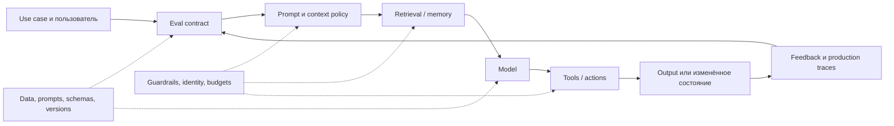

# 00. Карта AI Engineering

**Обновлено:** 2026-08-01

## От книги к этой базе

[Официальный репозиторий книги](https://github.com/chiphuyen/aie-book) задаёт сильную последовательность: foundation models → evaluation → prompting → RAG и agents → finetuning → data → inference → architecture и feedback. Здесь последовательность сохранена, но RAG и agents рассматриваются как отдельные инженерные дисциплины с собственными evaluation, security и production concerns.

| В книге | В этой базе |
| --- | --- |
| Introduction / AI stack | Карта + Product & Adoption |
| Foundation models | Models & Interfaces |
| Evaluation methodology + systems | Evaluation во всех слоях |
| Prompt engineering | Context engineering + Data & Adaptation |
| RAG and Agents | Два самостоятельных deep dive |
| Finetuning + Dataset engineering | Data & Adaptation |
| Inference optimization | Production |
| Architecture + feedback | Production + Product & Adoption + Safety |

## Рабочая модель системы

LLM — важный, но не единственный компонент. Качество приложения определяется контрактом задачи, контекстом, инструментами, данными, orchestration и наблюдаемостью не меньше, чем выбором модели.

## Пять контрактов

1. **Product contract:** какую работу пользователя система улучшает и что считается успехом.
2. **Evaluation contract:** dataset, rubrics, exact checks, cost/latency/safety budgets.
3. **Context contract:** какие данные разрешены, как они извлекаются, цитируются, обновляются и удаляются.
4. **Action contract:** какие tools доступны, их schemas, permissions, idempotency и approval policy.
5. **Operations contract:** версии, traces, retry/checkpoint, alerts, rollout и rollback.

Если один из контрактов отсутствует, новая модель или framework обычно только маскирует проблему.

## Лестница сложности

| Уровень | Когда достаточно | Что измерить перед следующим уровнем |
| --- | --- | --- |
| Prompt + structured output | Знания помещаются в контекст, действий нет | correctness, schema errors, stability |
| RAG | Нужны частные/свежие знания | retrieval recall, faithfulness, latency |
| Workflow | Путь известен, LLM выполняет отдельные шаги | outcome, step errors, retries |
| Single agent | Путь зависит от промежуточных результатов | task success, tool accuracy, budget, recovery |
| Multi-agent | Есть независимые параллельные ветви или отдельные trust domains | gain vs single agent, coordination cost |
| Finetuning | Повторяющийся behavioral gap не исправляется контекстом | gain vs prompt/RAG, data and serving cost |

## Что сейчас быстро меняется

- tool-rich agent runtimes: durable execution, sandboxes, human-in-the-loop;
- context engineering: just-in-time retrieval, compaction и external memory;
- agentic search/RAG: модель управляет несколькими retrieval-интерфейсами;
- interoperability: [MCP](https://modelcontextprotocol.io/specification/latest) для agent-to-tool и [A2A](https://a2a-protocol.org/latest/) для agent-to-agent;
- evaluation: outcome/final-state checks, trajectory diagnostics, simulated users/environments;
- security: prompt injection, excessive agency, memory poisoning и agent supply chain.

Эти области проверяются чаще остальных через [watchlist](../watchlist.json) и [adoption radar](../ADOPTION.md).

## Дальше

- [Evaluation](02-evaluation.md) — сначала определить измерения.
- [Context engineering и RAG](03-context-and-rag.md) — знания и evidence.
- [Агенты](04-agents.md) — действия и автономность.
- [Product и adoption](08-product-and-adoption.md) — процесс принятия подходов.

