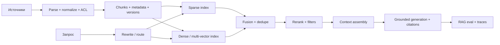

# 03. Context engineering и RAG

**Обновлено:** 2026-08-01

## Коротко

RAG — не «положить embeddings в vector DB». Это система управления evidence: ingestion → representation → retrieval → context assembly → grounded generation → evaluation → refresh/delete. Context engineering шире RAG и включает instructions, history, tool results, memory, compaction и just-in-time загрузку данных.

## Базовая архитектура



## Лестница baseline

Добавлять следующий шаг только после измеренного failure mode.

1. **Full context**, если corpus помещается и latency/cost приемлемы.
2. **BM25/lexical** — сильный baseline для терминов, имён, IDs и кода.
3. **Dense retrieval** — semantic similarity и paraphrases.
4. **Hybrid + rank fusion** — практичный default для смешанного corpus.
5. **Reranking** — более дорогая relevance model на небольшом candidate set.
6. **Context-preserving chunking** — parent/child, headings, surrounding context.
7. **Query transforms** — decomposition, multi-query, HyDE, metadata routing.
8. **Hierarchical/graph retrieval** — только для доказанных corpus-level/multi-hop gaps.
9. **Agentic retrieval** — модель решает, когда и как искать, с budget и stop rules.

## Ingestion и freshness

Для каждого документа хранить:

- stable source ID и canonical URL/path;
- owner, created/updated/indexed timestamps;
- content hash и parser version;
- access-control metadata, tenant и data classification;
- document hierarchy и chunk offsets;
- deletion/tombstone status;
- language, MIME/type и quality flags.

Index — производное представление, не источник истины. Reindex должен быть идемпотентным, а удаление — проходить через raw store, sparse/dense indexes, caches и agent memory.

## Chunking

Нет универсального размера. Экспериментировать с unit, который сохраняет смысл: section, paragraph, table, code symbol, conversation turn. Overlap помогает не всегда и создаёт duplicates.

Диагностические вопросы:

- потерялись ли заголовок, субъект, дата или единицы измерения;
- ответ требует одного passage или связи нескольких sections;
- таблица/код разрушены parser-ом;
- chunk можно правильно понять без родителя;
- retrieval возвращает evidence или только текст на похожую тему.

[Contextual Retrieval](https://www.anthropic.com/engineering/contextual-retrieval) предлагает добавлять chunk-specific context перед embedding и BM25 indexing. Рассматривать как trial: сравнивать с более дешёвыми metadata/parent-child baselines.

## Retrieval toolbox

| Техника | Где помогает | Риск/цена |
| --- | --- | --- |
| BM25 | exact terms, IDs, rare names | vocabulary mismatch |
| Dense bi-encoder | semantic match | false semantic neighbors |
| [ColBERTv2](https://arxiv.org/abs/2112.01488) / late interaction | более точное token-level matching | storage и serving complexity |
| Hybrid + RRF | смешанные запросы | tuning и duplicate control |
| Cross-encoder reranker | точный top-K | дополнительная latency |
| Metadata filters/router | tenants, time, product, source | плохие metadata дают false negatives |
| [HyDE](https://arxiv.org/abs/2212.10496) | vocabulary mismatch в zero-shot | drift от выдуманного документа |
| Query decomposition | compositional/multi-hop questions | больше calls и propagation errors |

## Продвинутые patterns

### Hierarchical retrieval / RAPTOR

[RAPTOR](https://arxiv.org/abs/2401.18059) строит дерево cluster summaries разных уровней. Это осмысленный кандидат для длинных документов и holistic/multi-hop вопросов, но expensive summaries, incremental updates и provenance требуют отдельного дизайна.

### GraphRAG

[Microsoft GraphRAG](https://github.com/microsoft/graphrag) извлекает structured graph и community summaries. Полезен, когда вопрос действительно про связи и глобальные themes across corpus. Не использовать как общий upgrade: indexing дорог, extraction ошибается, а обновление графа сложнее обычного index. В официальном репозитории прямо рекомендуется начинать с малого и учитывать indexing cost.

### Self-corrective RAG

- [Self-RAG](https://arxiv.org/abs/2310.11511) связывает retrieval, generation и self-reflection;
- [Corrective RAG](https://arxiv.org/abs/2401.15884) оценивает качество retrieval и корректирует путь.

Полезно изучать как patterns — retrieve when needed, critique evidence, fallback search — но production implementation лучше собирать из измеряемых компонентов, а не копировать paper pipeline целиком.

### Agentic RAG

Вместо одного retrieval call модель получает узкие интерфейсы, например:

```text
search_keywords(query, filters)
search_semantic(query, filters)
read_chunk(chunk_id)
read_parent(document_id, section_id)
```

[Официальный LangGraph tutorial](https://docs.langchain.com/oss/python/langgraph/agentic-rag) показывает подход как явный graph: модель решает, нужен ли retrieval; отдельные nodes выполняют search, relevance grading, query rewrite и grounded generation; conditional edges образуют retry loop. Это хорошая реализация, когда routing и циклы должны быть наблюдаемыми, ограничиваемыми и checkpointable.

LangGraph здесь решает orchestration, а не качество retrieval. Он не заменяет hybrid search, reranking, ACL, provenance и RAG eval. Tutorial также не является production benchmark: перед внедрением нужны max rewrite/retrieval attempts, общий budget, обработка empty/conflicting evidence и сравнение с one-shot RAG. Подробная оценка зрелости framework — в [разделе про агентов](04-agents.md#langgraph-актуальность-и-adoption).

[A-RAG](https://arxiv.org/abs/2602.03442) — свежий пример hierarchical retrieval interfaces; [Agentic-R](https://aclanthology.org/2026.findings-acl.785/) исследует retriever, обученный с учётом конечной полезности для multi-turn search. Это promising direction, но sequential decision-making добавляет over-search, under-search, loops, cost и новые security risks.

Использовать agentic RAG, если query требует адаптивного multi-step поиска. Для FAQ или одной policy lookup чаще лучше предсказуемый one-shot retrieval.

## Memory и RAG — не одно и то же

- **Knowledge RAG:** общая, версионируемая база фактов/документов.
- **Session state:** текущая задача, messages, checkpoints.
- **User memory:** предпочтения и факты о пользователе с consent/TTL/delete.
- **Episodic memory:** предыдущие trajectories и outcomes.
- **Procedural memory:** instructions, tools, skills и policies.

Не смешивать эти типы в одном index без ACL, provenance и retention policy. Memory write — отдельное рискованное действие: содержимое может быть ошибочным или poisoned.

## Evaluation matrix

| Слой | Что проверять |
| --- | --- |
| Parse | полнота, layout/tables/code, OCR errors |
| Index | freshness, deletion, ACL, duplicates |
| Retrieve | evidence Recall@K, MRR/nDCG, coverage by slice |
| Rerank | gain over fused candidates, latency |
| Context | evidence density, source diversity, token waste |
| Answer | correctness, faithfulness, citations, abstention |
| Robustness | unanswerable, conflicts, stale docs, prompt injection |

Для open-ended вопросов полезна идея [sub-question coverage](https://aclanthology.org/2025.naacl-long.301/). Для multi-turn — [mtRAG](https://aclanthology.org/2025.tacl-1.36/). Для enterprise deep search — [benchmark heterogeneous enterprise data](https://aclanthology.org/2025.emnlp-industry.34/).

## Production checklist

- [ ] Source-level ACL применяется до попадания context в модель.
- [ ] Ответ может показать источники и версии документов.
- [ ] Есть abstention/fallback при слабом evidence.
- [ ] Query, retrieved IDs/scores, reranked context и citations трассируются безопасно.
- [ ] Есть golden set и hard negatives.
- [ ] Reindex/delete/freshness измеряются.
- [ ] Prompt injection из документов моделируется как threat.
- [ ] Cache key учитывает corpus/model/prompt/index versions.
- [ ] Agentic retrieval имеет лимиты calls, tokens, time и domains.

## Рекомендуемый путь чтения

1. [Original RAG paper](https://arxiv.org/abs/2005.11401) — исходная формулировка.
2. [DPR](https://arxiv.org/abs/2004.04906) и [ColBERTv2](https://arxiv.org/abs/2112.01488) — retrieval foundations.
3. [Contextual Retrieval](https://www.anthropic.com/engineering/contextual-retrieval) — практический context-preserving pattern.
4. [RAPTOR](https://arxiv.org/abs/2401.18059) и [GraphRAG](https://microsoft.github.io/graphrag/index/overview/) — hierarchical/relational cases.
5. [A-RAG](https://arxiv.org/abs/2602.03442) и [Agentic-R](https://aclanthology.org/2026.findings-acl.785/) — переход к agentic search.
