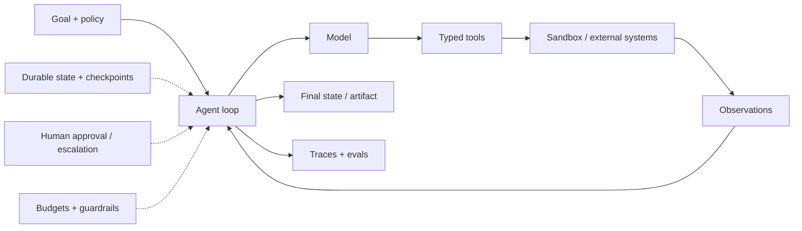

# 04. Агенты

**Обновлено:** 2026-08-01

## Определение

Рабочее определение: агент — модель, которая в цикле сама выбирает действия и tools на основе наблюдений до достижения цели, лимита или передачи решения человеку.

```text
goal → decide → act/tool → observe → update state → stop / ask / repeat
```

Если последовательность шагов известна заранее, это workflow с LLM-компонентами — обычно более простой и надёжный вариант. Полезное различие между workflow и agent разобрано в [Building effective agents](https://www.anthropic.com/engineering/building-effective-agents).

## Когда агент оправдан

- задача open-ended и путь зависит от промежуточных результатов;
- требуется несколько heterogeneous tools;
- ошибки можно обнаружить по observation и исправить;
- ценность результата покрывает дополнительные turns/cost;
- у задачи есть ясное состояние завершения или escalation;
- полномочия можно сузить и наблюдать.

Не начинать с агента для deterministic ETL, простого routing, одной retrieval операции или необратимых действий без approval.

## Production anatomy



Модель — planner/decision-maker, но harness отвечает за permissions, execution, state, retries, timeouts, budgets, observability и policy enforcement.

## Tool design

Хороший tool:

- имеет одно ясное назначение и отличимое имя;
- использует строгую schema и enum вместо свободного текста;
- возвращает compact structured observation и actionable errors;
- сообщает read-only он или state-changing;
- проверяет authentication/authorization вне модели;
- поддерживает idempotency key там, где возможен retry;
- имеет timeout, cancellation и rate limit;
- для опасного действия показывает пользователю точный diff/target перед approval.

Сначала 3–7 узких tools. Большой каталог ухудшает выбор; использовать namespacing, allowlist или tool search только после eval.

## Orchestration patterns

| Pattern | Когда использовать | Failure mode |
| --- | --- | --- |
| Prompt chaining | фиксированная последовательность | propagation error |
| Routing | классы задач известны | misrouting |
| Parallel fan-out/fan-in | независимые проверки/исследования | дубли, cost, synthesis loss |
| Orchestrator–workers | динамическая декомпозиция | плохие boundaries и coordination |
| Evaluator–optimizer | критерий можно проверять итеративно | бесконечный polishing loop |
| Handoff | отдельный specialist должен принять conversation | context loss, unclear ownership |
| Agent-as-tool | manager сохраняет контроль и вызывает specialist | bottleneck у manager |

Multi-agent нужен не из-за количества ролей в prompt. Он оправдан отдельными context windows, параллелизмом, trust boundaries или independently deployable services.

[Anthropic multi-agent research case study](https://www.anthropic.com/engineering/multi-agent-research-system) показывает сильный breadth-first use case, но также сообщает существенно больший token расход и сложность coordination. Поэтому статус multi-agent в этой базе — `Explore`.

## Context и memory

Context window — рабочая память, не база данных. Для длинных runs:

- хранить authoritative state вне prompt;
- checkpoint после значимого action;
- compact old turns, сохраняя goals, decisions, open items и artifact references;
- подгружать context just-in-time через tools;
- передавать subagent-ам task contract и ссылки на artifacts, а не весь transcript;
- версионировать memory writes и позволять delete/correct.

[Effective context engineering for AI agents](https://www.anthropic.com/engineering/effective-context-engineering-for-ai-agents) — хороший current overview just-in-time retrieval, compaction и context hygiene.

## Durable execution

Long-running agent — распределённая state machine с nondeterministic policy. Поэтому нужны:

- persistent run/task ID и state version;
- idempotent tool calls;
- checkpoint/replay/resume;
- retry policy по типу ошибки, а не слепой retry;
- deterministic side-effect boundary;
- cancellation и deadline;
- version pinning для активных runs;
- partial failure handling и compensation.

[LangGraph](https://langchain-ai.github.io/langgraph/index.html) фокусируется на durable execution, persistence и human-in-the-loop; [OpenAI Agents SDK](https://openai.github.io/openai-agents-python/) — на agent loop, tools, handoffs, guardrails, sessions и tracing; [Google ADK](https://adk.dev/) — на graph/multi-agent workflows, runtime, evaluation и deployment. Выбирать после требований и небольшого spike, а не по популярности.

## MCP и A2A

| Протокол | Граница | Использование |
| --- | --- | --- |
| [MCP](https://modelcontextprotocol.io/specification/latest) | agent/application ↔ tools, resources, prompts | стандартизировать подключение context и capabilities |
| [A2A](https://a2a-protocol.org/latest/) | independent agent ↔ independent agent | discovery, delegation и обмен task/results между opaque systems |

MCP не является agent framework, а A2A не нужен для обычного локального subagent call. Protocol adoption не отменяет allowlist, OAuth/scopes, consent, input validation и threat modeling. Фиксировать поддерживаемую версию spec: latest MCP на дату snapshot — 2026-07-28, A2A — 1.0.

## Human-in-the-loop

Approval нужен перед:

- отправкой сообщения/публикацией;
- покупкой, переводом денег, удалением и irreversible writes;
- повышением permissions или раскрытием данных;
- выполнением кода вне узкого sandbox;
- действием при высокой неопределённости или policy conflict.

Плохой approval: «Разрешить агенту продолжить?». Хороший: actor, exact action, target, diff, cost, source of instruction и возможность отклонить/изменить.

## Stop conditions и budgets

Harness должен ограничивать:

- max turns и max repeated action;
- token/tool/money budget;
- wall-clock deadline;
- allowed domains/resources;
- maximum delegation depth/fan-out;
- no-progress detection;
- escalation after ambiguity, conflict or repeated failure.

Модель может предложить остановку, но enforcement должен быть deterministic.

## Evaluation

Главное — task outcome/final state. Дополнительно:

- policy compliance;
- tool selection и argument correctness;
- trajectory efficiency;
- recovery и escalation;
- cost/latency per success;
- variance across repeated runs;
- adversarial environment/user/tool outputs.

Для state-changing agents создавать disposable simulated environment и проверять state diff. См. [Demystifying evals for AI agents](https://www.anthropic.com/engineering/demystifying-evals-for-ai-agents) и [evaluation section](02-evaluation.md).

## Security baseline

- treat all retrieved/tool content as untrusted data;
- least privilege и short-lived credentials;
- read/write tools разделены;
- sandbox для code/browser/computer use;
- egress allowlist и secret isolation;
- approval на high-impact actions;
- memory write validation и provenance;
- tool/MCP server supply-chain review;
- audit trail без бесконтрольного хранения sensitive content;
- tests на indirect prompt injection, confused deputy и data exfiltration.

Ориентиры: [OWASP Top 10 for Agentic Applications](https://genai.owasp.org/2025/12/09/owasp-top-10-for-agentic-applications-the-benchmark-for-agentic-security-in-the-age-of-autonomous-ai/) и [MCP security principles](https://modelcontextprotocol.io/specification/latest#security-and-trust-safety).

## First production agent checklist

- [ ] Есть сильный non-agent/workflow baseline.
- [ ] Цель и successful final state executable.
- [ ] Tools узкие, typed, permissioned и idempotent.
- [ ] Есть max turns/budget/no-progress stop.
- [ ] State/checkpoints живут вне context window.
- [ ] Side effects требуют appropriate approval.
- [ ] Traces содержат версии model/prompt/tool/schema/policy.
- [ ] Есть failure-injection eval: timeout, malformed output, stale data, prompt injection.
- [ ] Canary и rollback не ломают активные runs.

