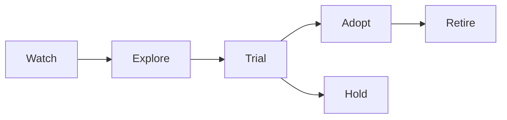

# 08. Product и adoption

**Обновлено:** 2026-08-01

## Начинать с работы, а не с технологии

Use case описывается через:

- кто пользователь и какую работу выполняет;
- текущий workflow и baseline time/cost/error;
- какую часть можно ускорить или улучшить;
- где требуется human judgment;
- цена неверного ответа/действия;
- как выглядит observable success через 2–6 недель.

«Сделать agentic RAG» — не use case. «Сократить время подготовки проверенного ответа support-инженером с 20 до 5 минут без роста ошибок» — use case.

## Adoption funnel



Каждый переход требует всё более сильных evidence и большего отношения к нашему workload. Paper benchmark — хороший сигнал для `Explore`, но недостаточен для `Adopt`.

## Карточка эксперимента

- hypothesis;
- current baseline;
- representative dataset и slices;
- success/failure metrics;
- engineering/time/money budget;
- stop condition;
- security/privacy review;
- expected operational complexity;
- result и decision date/owner.

Использовать [шаблон adoption review](../templates/adoption-review.md).

## Build order для AI-функции

1. Shadow/manual prototype: проверить полезность результата.
2. Offline eval contract и baseline.
3. Copilot/draft с явным review пользователем.
4. Limited tool use, read-only где возможно.
5. Scoped writes с approval.
6. Partial automation только для low-risk/high-confidence slices.
7. Расширять автономность по данным, а не обещаниям модели.

## Metrics tree

```text
Product outcome
├── adoption: activation, repeat usage, retained workflows
├── quality: task success, edits, escalations, complaints
├── efficiency: time saved, throughput, cost per success
├── trust: citation use, overrides, approval rejection
└── risk: policy violations, incidents, near misses
```

Model score — leading indicator, не продуктовый outcome.

## Buy / build / protocol / framework

Принимать решение по:

- differentiation: является ли компонент продуктовым moat;
- control и portability;
- privacy/compliance;
- reliability/SLA и debugging;
- total cost of ownership;
- migration/deprecation risk;
- team skill и speed;
- open standards boundary (например, MCP/A2A) там, где interoperability действительно нужна.

Не строить internal platform до появления 2–3 реальных workloads с повторяющимися требованиями.

## Как читать новые статьи

Задать пять вопросов:

1. Что является baseline и честно ли сравнение?
2. Dataset похож на наш workload?
3. Какова полная стоимость — indexing, tokens, latency, humans, infra?
4. Какие ablations показывают источник выигрыша?
5. Какие failure modes, security и operational costs не измерены?

После этого назначить `watch`, `explore`, `trial` или `drop`. Новый термин без отдельного measurable benefit не требует новой архитектурной сущности.

## Quarterly review

- удалить/заменить устаревшие model/API snapshots;
- проверить все `Trial` без owner/result;
- сравнить `Adopt` practices с новыми production failures;
- закрыть `Explore`, которые не дошли до эксперимента;
- обновить risk register и incident learnings;
- выбрать максимум 1–2 новых технических bets на квартал.

